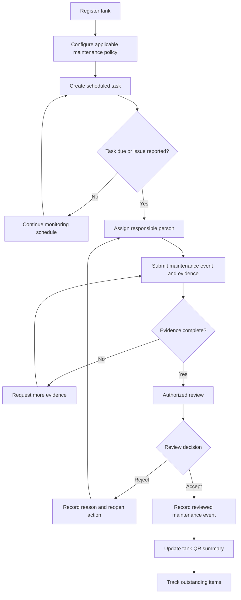
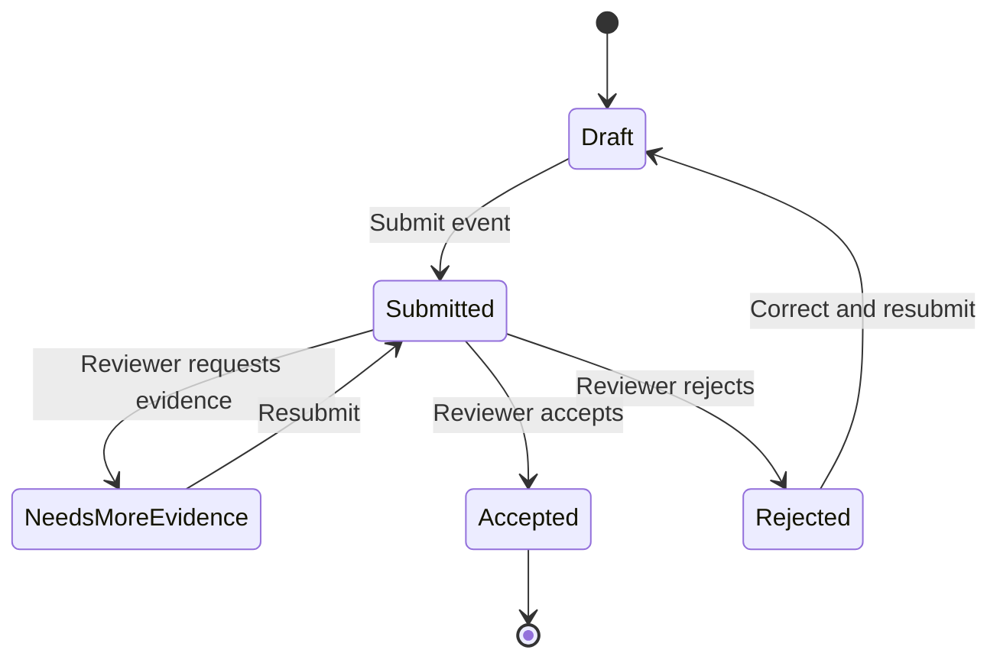
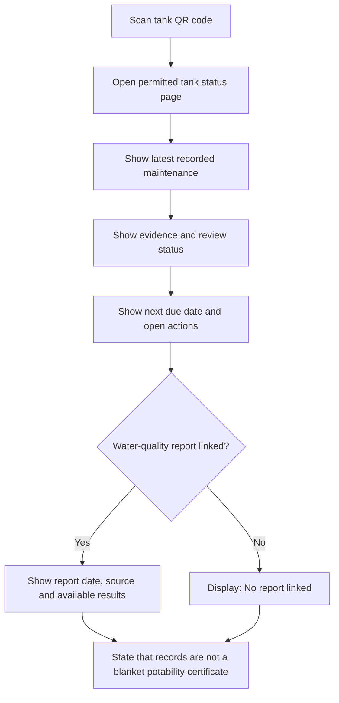
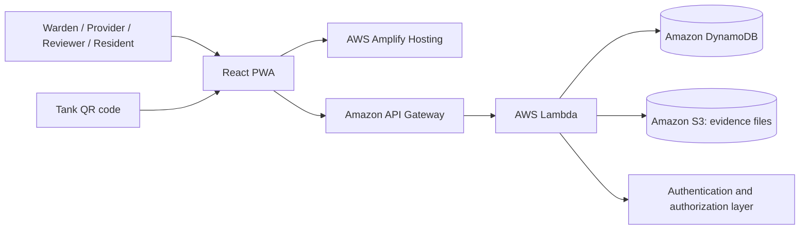

# DHARA — Institutional Water Evidence Ledger

**Track the maintenance. Review the evidence. Keep water-quality results separate.**

> DHARA helps hostels, schools, campuses and other institutions organize water-storage maintenance records, supporting evidence, review decisions and water-quality reports in one traceable workflow.


**DHARA is a prototype in development.** This README describes its product intent and proposed MVP. Features should only be described as implemented after they have been built and tested in this repository.

---

## Table of Contents

- [The problem](#the-problem)
- [The idea](#the-idea)
- [What makes DHARA different](#what-makes-dhara-different)
- [Who it is for](#who-it-is-for)
- [Product workflow](#product-workflow)
- [Workflow and system diagrams](#workflow-and-system-diagrams)
- [Evidence and status model](#evidence-and-status-model)
- [Technical architecture](#technical-architecture)
- [Proposed data model](#proposed-data-model)
- [Security, privacy and trust boundaries](#security-privacy-and-trust-boundaries)
- [Environmental impact and evaluation](#environmental-impact-and-evaluation)
- [MVP scope](#mvp-scope)
- [Technology choices](#technology-choices)
- [Local development](#local-development)
- [Configuration](#configuration)
- [Deployment overview](#deployment-overview)
- [Three-minute demo plan](#three-minute-demo-plan)
- [Limitations](#limitations)
- [Roadmap](#roadmap)
- [Research and references](#research-and-references)

---

## The problem

Water does not become safe simply because it has reached a building. Storage tanks need appropriate maintenance, and institutions need a reliable way to track that work and the evidence associated with it.

In practice, information may be spread across paper registers, photographs, invoices, messaging apps and laboratory PDFs. That can make it difficult for a facility manager to answer basic questions quickly:

- Which tank is due for maintenance?
- When was the last maintenance event recorded?
- Who submitted the record, and what evidence was attached?
- Has an authorized person reviewed the evidence?
- Is a relevant water-quality report available, and when was the sample collected?
- Which actions remain open, and who is responsible for resolving them?

The gap is not just missing data. It is the gap between a maintenance obligation, evidence of work, an accountable review and documented follow-through.

### Three things that must not be confused

| Concept | What it can establish | What it cannot establish by itself |
|---|---|---|
| **Maintenance record** | A maintenance event was entered into the system | That the work was performed correctly or made water potable |
| **Supporting evidence** | Files and details were submitted for review | That a photograph is genuine, complete or independently verified |
| **Water-quality report** | A laboratory or testing provider reported results for a particular sample and set of parameters | That every part of a tank is safe at all times, or that a different sample has the same result |

DHARA keeps these concepts separate by design.

## The idea

DHARA is a mobile-first water-storage maintenance and evidence-management platform. Each registered tank gets a unique QR code that opens an appropriate status page. Authorized users can record maintenance, attach supporting evidence, review submissions, link water-quality reports and track outstanding follow-up.

Instead of displaying an opaque “water safety score,” DHARA shows what is known, what has been documented, what has been reviewed and what remains missing.

### The core loop

**Register → Schedule → Submit evidence → Review → Follow up → Retrieve the record**

The product's central promise is operational: help institutions make required maintenance easier to track, review and close out.

## What makes DHARA different

DHARA is not positioned as a tank-cleaning marketplace, an AI biofilm detector or a certificate that declares water safe from a photograph. Its proposed differentiator is an **institutional evidence workflow** connecting maintenance obligations with accountable review and separate water-quality records.

### 1. Maintenance and testing remain separate

A completed cleaning event does not automatically mark water as safe. Water-quality reports are recorded separately, with their own sample date, source, parameters, results and review status.

### 2. Evidence is reviewed, not blindly trusted

The system records who submitted an event, what evidence was attached and which authorized reviewer accepted, rejected or returned it for more information.

### 3. Missing information creates follow-up

Overdue maintenance, missing required evidence and missing expected reports can create actionable tasks. The workflow ends when a responsible person records a resolution—not when a dashboard simply changes color.

### 4. QR access makes records easier to retrieve

A user can scan a tank's QR code to access the permitted maintenance summary without navigating a large institutional system. Sensitive documents and personal information remain subject to access controls.

### 5. The claims are deliberately bounded

Timestamps, photographs, checksums and review records improve traceability, but do not prove every fact about the physical world. DHARA communicates those limits instead of turning incomplete evidence into a false safety guarantee.

## Who it is for

| Role | Primary need | DHARA capability |
|---|---|---|
| **Warden / facility manager** | See which tanks need attention and manage maintenance obligations | Tank registry, schedule, outstanding actions and audit view |
| **Maintenance provider** | Submit work details and supporting evidence | Maintenance submission and evidence upload |
| **Authorized reviewer** | Decide whether a record is sufficiently documented | Accept, reject or request-more-evidence workflow |
| **Student / resident** | Understand what has been recorded for a tank | QR-accessible maintenance summary and water-quality-report status |
| **Auditor / authorized administrator** | Retrieve a history of events and decisions | Searchable records and exportable evidence history, when implemented |

The first release should target one manageable setting—such as a hostel or campus building—rather than attempting to serve every kind of institution at once.

## Product workflow

1. **Register a tank.** Create a unique record for a tank, including its building, responsible role, last recorded maintenance date and institution-defined schedule.
2. **Create a maintenance task.** Calculate its due date from the configured policy and show who is responsible.
3. **Submit the event.** Record the service date, provider details, completion note and supporting photographs or documents.
4. **Review the submission.** An authorized reviewer accepts it, rejects it or asks for further evidence. The decision and reason are recorded.
5. **Link a water-quality report.** Add the sample date, laboratory or testing provider, reported parameters, result and report file as a separate record.
6. **Show the QR status.** Display a clear summary of maintenance and the availability of water-quality evidence, without implying that either proves overall potability.
7. **Resolve outstanding actions.** Assign a follow-up when a required event or record is missing and record how the issue was resolved.

## Workflow and system diagrams

### End-to-end maintenance workflow



### Maintenance status model

Maintenance review status is separate from evidence availability and water-quality status. A lab report can be linked before or after a maintenance review; it is not a final state in a mandatory linear chain.



**Separate water-quality report lifecycle:** `Not linked → Linked → Reviewed` (with any result or review outcome shown exactly as reported). “Linked” means a report is present; it does not mean a laboratory has confirmed that all water is safe.

### User journey: scanning a tank QR code



### System architecture



The diagram shows the proposed target architecture. Authentication and authorization must be enforced in the backend; a role selector in the frontend is not a security boundary. If Amazon Cognito or another identity provider is used, document and configure the actual implementation rather than implying it is already deployed.

## Evidence and status model

DHARA must show distinct statuses rather than compressing every fact into a single “verified” badge.

### Maintenance event fields

- `eventId`: unique maintenance event identifier
- `tankId`: tank this event belongs to
- `submittedBy`: authenticated submitter identity
- `submittedAt`: server-side submission timestamp
- `serviceDate`: date the submitter says work occurred
- `providerName`: provider or technician details, when supplied
- `evidenceFiles`: references to associated files and their stored metadata
- `reviewStatus`: `SUBMITTED`, `NEEDS_MORE_EVIDENCE`, `ACCEPTED` or `REJECTED`
- `reviewedBy`, `reviewedAt`, `reviewNote`: reviewer details, when reviewed
- `policyReference`: institution-configured schedule or requirement used for the due date

### Water-quality record fields

- `reportId` and `tankId`
- `sampleDate` and `reportDate`, where available
- `laboratoryOrProvider`
- `reportedParameters` and results exactly as supplied by the report
- `reportFileKey` and file metadata
- `recordStatus`: for example, `LINKED` or `REVIEWED`
- `reviewNote`, where applicable

Do not infer a result that is absent from the report. Preserve units, dates, parameter names and source context when displaying test results.

## Technical architecture

The proposed implementation favors a small number of services with clear responsibilities.

| Component | Responsibility |
|---|---|
| **React + TypeScript PWA** | Mobile-first user interface, QR landing page, submission and review workflows |
| **AWS Amplify Hosting** | Frontend deployment |
| **Amazon API Gateway** | API entry point |
| **AWS Lambda** | Input validation, due-date rules, state transitions and task handling |
| **Amazon DynamoDB** | Structured records for tanks, maintenance events, reviews, reports and actions |
| **Amazon S3** | Photo and report storage, preferably through short-lived authorized upload/download URLs |
| **Authentication provider** | User identity and role-based access, if implemented in the MVP |

No machine-learning model is required for the core workflow. That is intentional: the first release solves the tracking and accountability problem without making unsupported claims about visual inspection or water safety.

## Proposed data model

The initial implementation can use separate DynamoDB tables or a documented single-table design. The important part is the relationships and authorization model, not the number of tables.

### Core entities

| Entity | Key fields | Relationship |
|---|---|---|
| `Institution` | `institutionId`, `name`, `policyConfig` | Owns buildings and tanks |
| `Building` | `buildingId`, `institutionId`, `name` | Contains tanks |
| `Tank` | `tankId`, `buildingId`, `label`, `policyId`, `responsibleRole` | Has many maintenance events and reports |
| `MaintenanceEvent` | `eventId`, `tankId`, `submittedBy`, `submittedAt`, `reviewStatus` | Belongs to one tank |
| `EvidenceFile` | `fileId`, `eventId`, `s3Key`, `checksum`, `uploadedAt` | Supports a maintenance event or report |
| `Review` | `reviewId`, `eventId`, `reviewerId`, `decision`, `reviewedAt` | Records a review decision |
| `WaterQualityReport` | `reportId`, `tankId`, `sampleDate`, `provider`, `reportFileKey` | Separate from maintenance-event state |
| `ActionItem` | `actionId`, `tankId`, `ownerId`, `dueAt`, `status`, `resolution` | Tracks follow-up and closure |

Validate all IDs, ownership relationships and permissions on the server. Do not accept a client-provided `reviewerId`, timestamp or role as proof of authority.

## Security, privacy and trust boundaries

DHARA handles photographs of physical infrastructure, potentially sensitive institution records and reports that may identify people or locations. Security and honest evidence labels are core product behavior, not optional polish.

### Minimum security principles

- **Backend authorization:** verify the authenticated actor and permission for every write, review and restricted read.
- **Least privilege:** use separate IAM permissions for frontend hosting, API functions, database access and object storage.
- **Private evidence storage:** keep S3 buckets private; use narrowly scoped, short-lived pre-signed URLs where appropriate.
- **Input validation:** validate file type, size, event ownership, IDs and all state transitions on the server.
- **Audit events:** record submissions, review decisions and meaningful state changes with actor and server timestamp.
- **Privacy by default:** expose only the summary required on a public or shareable QR page; protect personal details and full reports.
- **Retention and deletion:** document who can access, retain and remove records. Do not collect raw data that the workflow does not need.
- **Secrets management:** never commit cloud credentials or private keys to the repository.

### What evidence means

| Mechanism | Useful for | Not proof of |
|---|---|---|
| Server timestamp | When the service received a request | When the physical work actually happened |
| File checksum | Detecting byte changes when compared with a trusted stored digest | Authenticity or truth of the original photograph |
| QR code | Locating a tank's record | Tank identity unless registration and physical labeling are controlled |
| Human review record | Who made a recorded review decision | Independent verification that work happened as described |
| Laboratory report | Results reported for a sample and tested parameters | Continuous safety for all water in all conditions |

Ordinary S3 storage is not automatically immutable. If stronger retention protection becomes necessary, evaluate S3 Versioning and S3 Object Lock and configure the required policies deliberately. See [AWS S3 integrity documentation](https://docs.aws.amazon.com/AmazonS3/latest/userguide/checking-object-integrity.html), [S3 Versioning](https://docs.aws.amazon.com/AmazonS3/latest/userguide/Versioning.html) and [S3 Object Lock](https://docs.aws.amazon.com/AmazonS3/latest/userguide/object-lock.html).

## Environmental impact and evaluation

The MVP should measure outcomes it can actually observe. It must not claim that recording maintenance alone reduces contamination or prevents illness.

Suggested pilot metrics:

| Metric | Definition |
|---|---|
| Maintenance coverage | Share of registered tanks with a configured maintenance policy and responsible role |
| Evidence completeness | Share of submitted events that include all evidence required by the institution's configured workflow |
| Review turnaround | Time between event submission and the review decision |
| Follow-up closure | Share of due action items marked resolved with a recorded outcome |
| Record retrieval time | Time required for an authorized user to find the requested tank's maintenance and report history |
| Report linkage | Share of applicable tank records with the expected report status explicitly recorded |

A real pilot should establish a baseline before claiming improvement. Water-quality outcomes require appropriate testing and separate evaluation.

## MVP scope

### Planned for the hackathon MVP

- [ ] Register an institution and tanks
- [ ] Generate a QR code for each tank
- [ ] Configure a maintenance schedule per institution or tank
- [ ] Create a maintenance event with notes and supporting evidence
- [ ] Store evidence files and record their metadata
- [ ] Implement authorized accept, reject and request-more-evidence actions
- [ ] Display a QR-accessible maintenance summary
- [ ] Link a separate water-quality report and show whether a report is missing
- [ ] Create and resolve a follow-up action for overdue or incomplete items
- [ ] Demonstrate the real AWS-backed workflow end to end
- [ ] Add tests for authorization, invalid transitions, missing evidence and error paths

Update this checklist as features are implemented and tested. Do not leave a feature checked merely because a screen or mock response exists.

### Explicitly out of scope for the first version

- AI certification that water is safe to drink
- Biofilm detection from a small photo dataset
- Automatic inference of microbiological contamination from photographs
- A cleaning-service marketplace or payments
- A universal legal-compliance claim for every institution
- Claims of immutable or fraud-proof records without the corresponding controls
- Predictive health claims or unmeasured environmental savings

## Technology choices

The proposed MVP uses:

- **Frontend:** React, TypeScript and a mobile-first PWA
- **Hosting:** AWS Amplify Hosting
- **API:** Amazon API Gateway and AWS Lambda
- **Database:** Amazon DynamoDB
- **Evidence storage:** Amazon S3
- **QR access:** a unique URL associated with each registered tank
- **Testing:** unit tests for validation and state transitions, plus end-to-end workflow tests

This is a proposed stack. Keep the README aligned with the actual dependency files and deployed resources as the implementation evolves.

## Local development

The repository is still in development, so the commands below are a starting convention. Adjust them to match the actual scripts and infrastructure files committed to this repository.

### Prerequisites

- A supported Node.js LTS release and npm
- Git
- An AWS account and appropriately scoped development credentials for cloud integration tests
- AWS CLI and the chosen deployment tooling, if deploying from the terminal

### Install and run

```bash
git clone <YOUR_REPOSITORY_URL>
cd <YOUR_REPOSITORY_DIRECTORY>
npm install
cp .env.example .env.local
npm run dev
```

`npm run dev` and `.env.example` should be included by the implementation. If they do not exist yet, update this section when the project scaffold is committed. Never put AWS access keys in a frontend environment file or commit secrets to Git.

### Tests

```bash
npm test
npm run build
```

These scripts are recommended conventions, not a claim that the current repository already contains them. Add and run tests for the workflow before treating a build as release-ready.

## Configuration

Document the actual environment variables in `.env.example` and keep the example free of secrets. A likely configuration set for the proposed architecture is:

| Variable | Purpose |
|---|---|
| `VITE_API_BASE_URL` | Base URL for the deployed API |
| `VITE_PUBLIC_TANK_BASE_URL` | Base URL used to construct tank QR links |
| `AWS_REGION` | AWS region configured for backend deployment; backend-only where possible |
| `TANKS_TABLE_NAME` | Tank record table or its equivalent in the chosen data model |
| `EVENTS_TABLE_NAME` | Maintenance-event record table or its equivalent |
| `REPORTS_TABLE_NAME` | Water-quality record table or its equivalent |
| `EVIDENCE_BUCKET_NAME` | Private S3 bucket for evidence storage |

These names are illustrative. Use only variables the implementation actually reads. Frontend variables prefixed with `VITE_` are exposed to the client and must never contain secrets.

## Deployment overview

1. Provision the database, private evidence bucket, execution roles and API resources.
2. Configure authentication and backend authorization before exposing write or review operations.
3. Deploy the API and set its environment variables and least-privilege permissions.
4. Deploy the PWA to Amplify and configure the API base URL.
5. Test tank registration, file upload, review permissions, QR access and follow-up closure against the deployed environment.
6. Verify that no private evidence is publicly accessible without authorization.
7. Capture the deployed API request and response for the hackathon demo.

Check service-specific pricing, quotas and regional availability before deployment. The presence of free-tier credits does not guarantee every configuration will remain free.

## Three-minute demo plan

A strong demo should show the product performing a complete workflow—not a slide deck describing future capabilities.

| Time | Demonstration |
|---|---|
| **0:00–0:25** | Explain the institutional problem: maintenance records, evidence and lab reports are difficult to track together. |
| **0:25–0:55** | Register a tank, configure an example policy and generate its QR code. |
| **0:55–1:25** | Submit a maintenance event and upload clearly labeled demo evidence. |
| **1:25–1:55** | Sign in as an authorized reviewer and accept, reject or request more evidence. |
| **1:55–2:20** | Scan the QR code and show maintenance-review status separately from water-quality-report status. |
| **2:20–2:45** | Show an overdue or incomplete action and record its resolution. |
| **2:45–3:00** | Show the real AWS integration and summarize the measured outcome the product is designed to improve. |

Use real data only when you have permission and can represent it accurately. Clearly label synthetic records and demonstration photographs. Never imply that the demo describes an actual institution if it does not.

## Limitations

- DHARA records information supplied by users; it cannot guarantee that every submission reflects what happened physically.
- A photo can document visible conditions but cannot establish microbiological or chemical water safety.
- A maintenance event is not a substitute for the relevant water-quality test.
- A linked PDF does not independently prove the laboratory, sample chain of custody or validity of the reported results.
- A QR code is only as trustworthy as the registration and labeling process behind it.
- Server timestamps and checksums improve traceability but are not, by themselves, proof against fraud or administrator-level tampering.
- Maintenance schedules and regulatory requirements depend on the institution and applicable policy. Do not assume one guideline applies universally.
- The MVP's impact must be evaluated with real users and records before broader environmental or commercial claims are made.

## Roadmap

### Phase 1 — Working prototype

Tank registration, QR status page, maintenance evidence upload, review actions, separate report linking and follow-up tracking.

### Phase 2 — Pilot validation

Test the workflow with a consenting institution. Measure record-retrieval time, evidence completeness, review turnaround and follow-up closure against the existing process.

### Phase 3 — Stronger governance controls

Add more granular roles, exportable audit history, retention policies, stronger evidence-integrity controls and institution-level reporting based on validated user needs.

### Phase 4 — Integrations and expansion

Consider laboratory integrations and related maintenance workflows, such as air-purifier filter replacement records, only after the water-maintenance workflow demonstrates value.

## Research and references

- **Government of India's National Health Mission — Kayakalp Implementation Guidebook:** includes guidance for applicable healthcare facilities on cleaning water-storage tanks and keeping cleaning records. Its institutional requirements should not be assumed to apply to every hostel or school. [Read the guidebook](https://nhm.gov.in/images/pdf/in-focus/Implementation_Guidebook_for_Kayakalp.pdf)
- **Amazon S3 — Checking object integrity:** describes checksums for validating uploaded and downloaded data. [AWS documentation](https://docs.aws.amazon.com/AmazonS3/latest/userguide/checking-object-integrity.html)
- **Amazon S3 — Versioning:** describes retaining multiple versions of objects to aid recovery from accidental overwrites or deletions. [AWS documentation](https://docs.aws.amazon.com/AmazonS3/latest/userguide/Versioning.html)
- **Amazon S3 — Object Lock:** describes retention-based protection for object versions and its configuration requirements. [AWS documentation](https://docs.aws.amazon.com/AmazonS3/latest/userguide/object-lock.html)

These references support the design rationale; they do not certify DHARA, establish that a particular tank is unsafe or prove that the proposed product has already achieved an environmental outcome.

## Contributing

Contributions, issue reports and implementation feedback are welcome once the repository's contribution and licensing terms are published. Please do not submit real personal information, private laboratory reports or identifiable infrastructure photographs in public issues.

## License

Add the project's chosen license before inviting reuse or external contributions. Until a license is present in the repository, do not assume the code is open source or available for unrestricted reuse.

---

**DHARA — Because maintenance should be documented, evidence should be reviewable, and water quality should be supported by the right evidence.**
