<p align="center">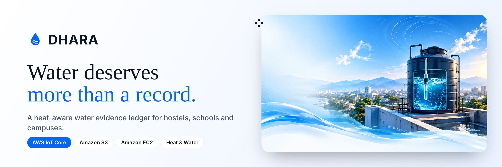</p>

<p align="center">
  <a href="https://43-204-133-35.sslip.io/"><b>Live app</b></a> ·
  <a href="#4-live-proof-on-aws"><b>Live AWS proof</b></a> ·
  <a href="#3-dhara-in-four-moments"><b>Product</b></a> ·
  <a href="#5-how-it-runs-on-aws"><b>Architecture</b></a> ·
  <a href="docs/TECHNICAL.md"><b>Technical reference</b></a> ·
  <a href="deploy/aws/iot/README.md"><b>IoT setup</b></a>
</p>

<p align="center">Environmental Hacks 2026 · WeMakeDevs × AWS · Track: Heat and Water</p>

<p align="center">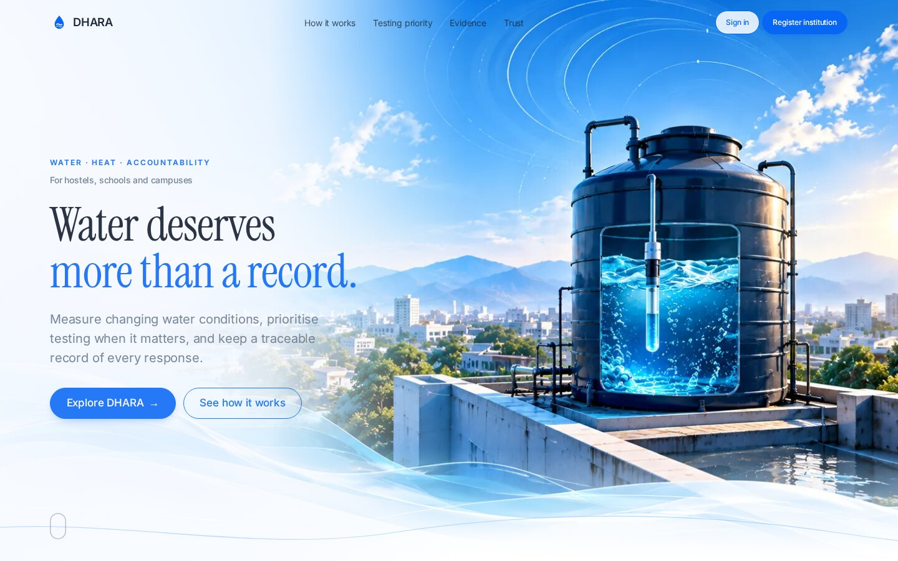<br><sub>The DHARA landing page: React + TypeScript, served by Django.</sub></p>

**DHARA** (धारा, "stream") is a water evidence ledger for hostels, schools and campuses. It measures what happens inside rooftop tanks, tells staff **which tank to test next** when heat puts chlorine at risk, and keeps verifiable proof of every response, from a technician's reading to a warden's decision. Readings travel from an in-tank probe through **AWS IoT Core** to DHARA on **Amazon EC2**, with a raw archive in **Amazon S3**.

DHARA never claims water is safe to drink. It shows what was measured, what was done and what still needs doing.

> **Demo video (3:04):** *link added at submission.* Every AWS screen in it was recorded live on 11 October 2026.

---

## 1. The problem

<table><tr>
<td width="55%" valign="top">

**A register can say a tank was cleaned. It cannot say whether the water is safe today.**

Across India, institutions store drinking water in rooftop tanks. On a summer roof those tanks bake in the sun, and the chlorine residual that keeps water protected after it leaves the plant gets harder to maintain.

- **About 2 lakh people die every year in India due to inadequate access to safe water.** NITI Aayog, *Composite Water Management Index*, June 2018.
- **India's standard asks for at least 0.2 mg/L of free residual chlorine, tested at the consumer end.** BIS IS 10500:2012. WHO recommends 0.2–0.5 mg/L at the point of collection (Technical Note 11).
- **"Maintaining protective residuals can be challenging at high temperatures."** Furst et al., *Water Research*, 2024 ([doi:10.1016/j.watres.2024.121913](https://doi.org/10.1016/j.watres.2024.121913)).

</td>
<td width="45%">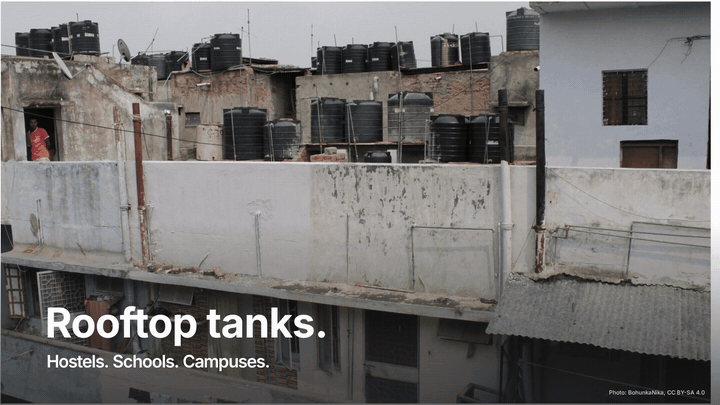</td>
</tr></table>

<table><tr>
<td width="45%">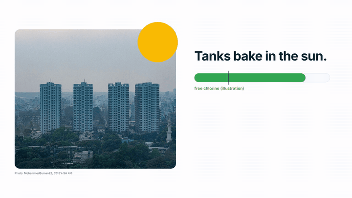</td>
<td width="55%" valign="top">

**And the evidence is scattered.** When someone asks what was checked, an institution typically has a register that says *cleaned*, photos on someone's phone and a lab report lost in email. Nobody can show who measured what, when, with which method, or who reviewed it.

DHARA keeps four things **separate**, because merging them creates false confidence:

| | Answers | Cannot establish alone |
|---|---|---|
| **Measurement** | How warm, how much chlorine, when, by what method | That the whole tank is safe |
| **Maintenance** | What work was recorded, for which date | That it was done correctly |
| **Evidence** | Which photos and documents support it | That a photo is genuine |
| **Review** | Who decided, when and why | Independent verification |

</td></tr></table>

---

## 2. What DHARA does

| | Feature | How |
|---|---|---|
| 🌡️ | **Measure** | Technicians record tank-water temperature and free chlorine with method, sample point and measured-at vs entered-at time. An in-tank probe streams temperature through AWS IoT Core. |
| 🎯 | **Prioritise** | A transparent rule engine ranks tanks for *warden review*, *repeat measurement* or *scheduled test* from reading age, configured thresholds and the Open-Meteo heat forecast, and shows every rule that fired. It ranks measurement work; it never predicts chlorine. |
| 🧾 | **Prove** | Maintenance is submitted with photos and documents, each fingerprinted with **SHA-256** and re-checkable later. The submitter can never approve their own work; a warden accepts, rejects or asks for more, with a reason. |
| 📌 | **Follow up** | Unmet schedules, missing lab reports and urgent readings open follow-ups with an owner and a due date. A task closes only when someone records what was done. |
| 📱 | **Public QR page** | Every tank gets a QR code that opens a read-only status page: no login, no private details. |
| 📈 | **Thermal twin** | A heat-balance model fitted to each tank's own readings, shown only after it passes held-out validation, and used to measure whether a cooling intervention (paint, shade, insulation) actually lowered the daily peak. |

---

## 3. DHARA in four moments

<table>
<tr>
<td width="50%" valign="top">

**① A technician records a reading.** Free chlorine **0.15 mg/L** from a DPD strip at the tank outlet. DHARA stores the method, who entered it and both timestamps.

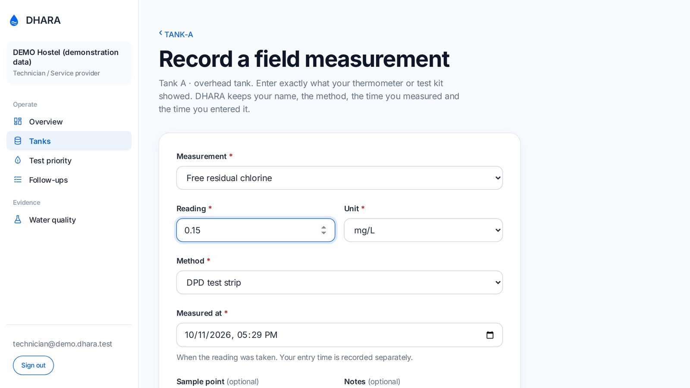

</td>
<td width="50%" valign="top">

**② Testing priority reacts.** 0.15 is below the 0.2 mg/L minimum, so TANK-A becomes **Urgent: warden review**, with the exact rule and the heat context shown.

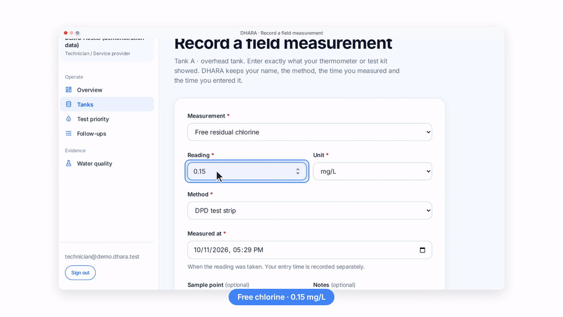

</td>
</tr>
<tr>
<td valign="top">

**③ Evidence is fingerprinted.** Before and after photos are stored privately with SHA-256 digests. **Re-check digest** recomputes the hash from the stored file and confirms it matches.

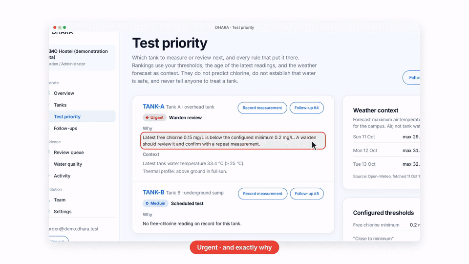

</td>
<td valign="top">

**④ A warden decides, never the submitter.** The decision, note, name and time are recorded, and the event history keeps every step.

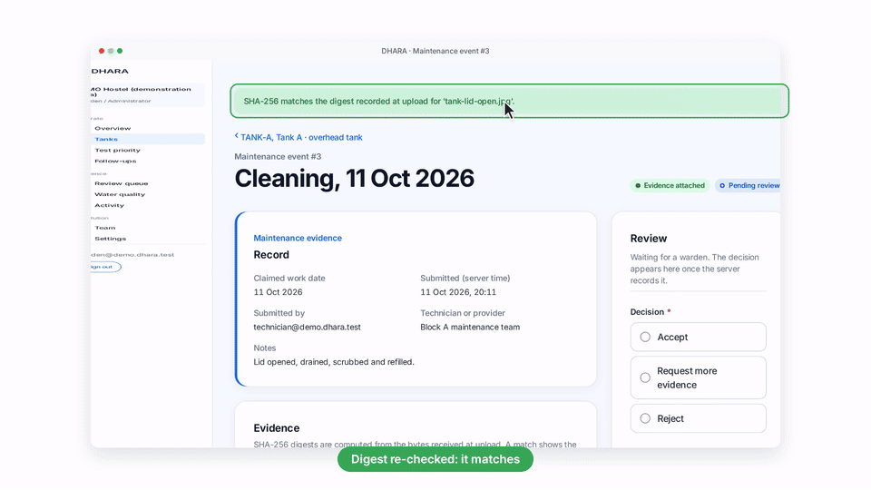

</td>
</tr>
</table>

<table><tr>
<td width="62%">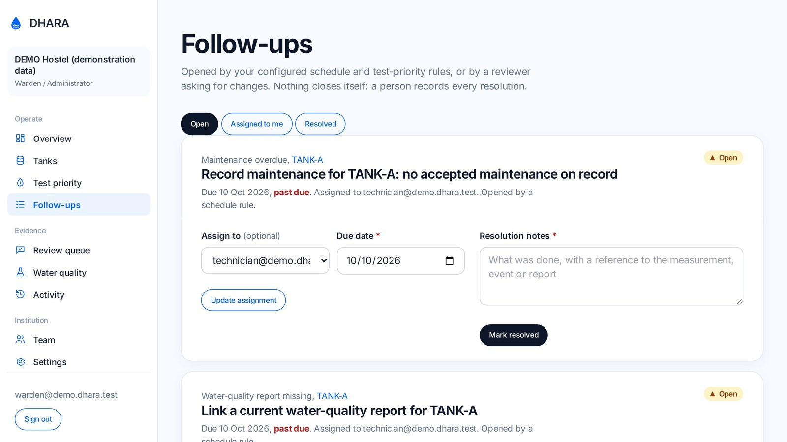<br><sub>Follow-ups: every open task has an owner and a due date.</sub></td>
<td width="38%" align="center">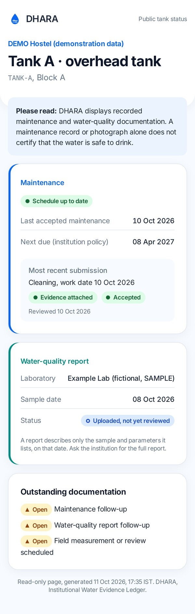<br><sub>The public QR page: no login, no private details.</sub></td>
</tr></table>

---

## 4. Live proof on AWS

No ESP32 hardware was available before the deadline, so the probe runs on **[Wokwi](https://wokwi.com)**, a browser ESP32 simulator, with the same firmware logic. **Everything after the device is real AWS**, recorded live on 11 October 2026.

<p align="center">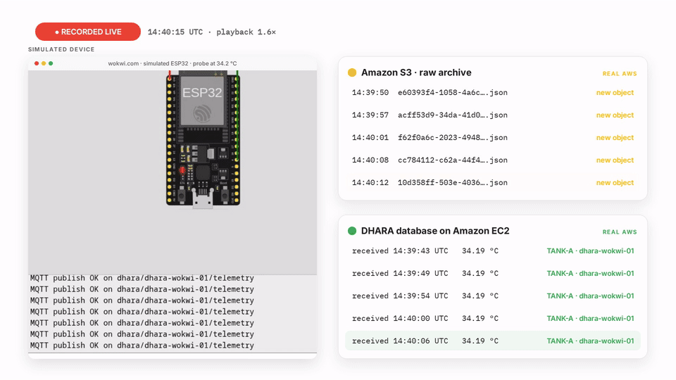</p>

The simulated board (probe set to 34.2 °C) publishes every 5 seconds over MQTT/TLS with its own X.509 certificate. Pollers watched Amazon S3 and DHARA's database on EC2 at the same time: each message produced a new S3 object, and the same reading was stored by DHARA.

| AWS IoT Core: thing, rules, enabled HTTPS destination | Live run: S3 arrivals and database receipts |
|---|---|
| 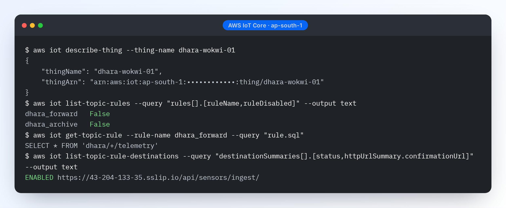 | 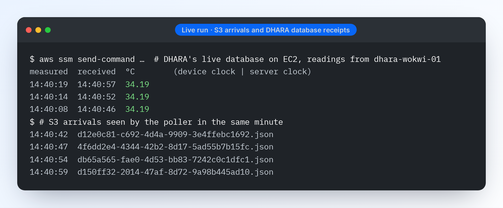 |

| Amazon S3: archive count, private bucket, encryption | Amazon EC2: running, HTTPS 200, SSH closed |
|---|---|
| 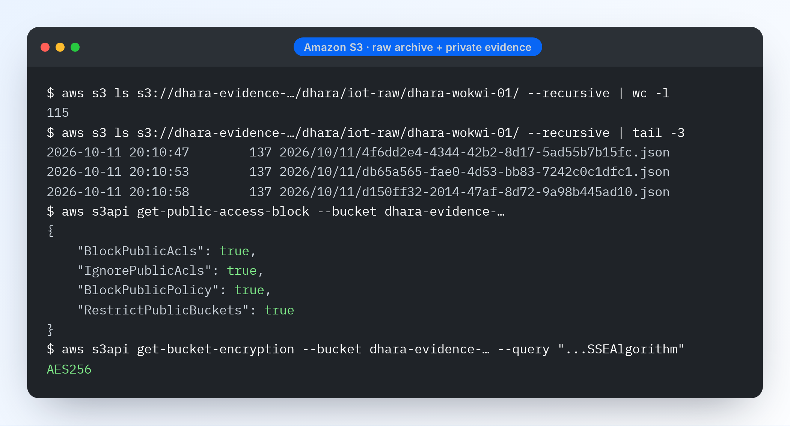 | 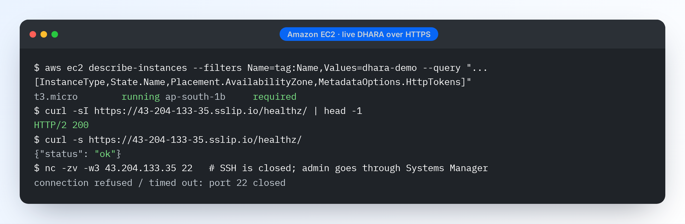 |

<sub>Real CLI output; the AWS account id is masked. Reproduce with the commands in <a href="deploy/aws/iot/README.md">deploy/aws/iot/README.md</a> and the Wokwi sketches in <a href="firmware/wokwi/">firmware/wokwi/</a>.</sub>

---

## 5. How it runs on AWS

<p align="center">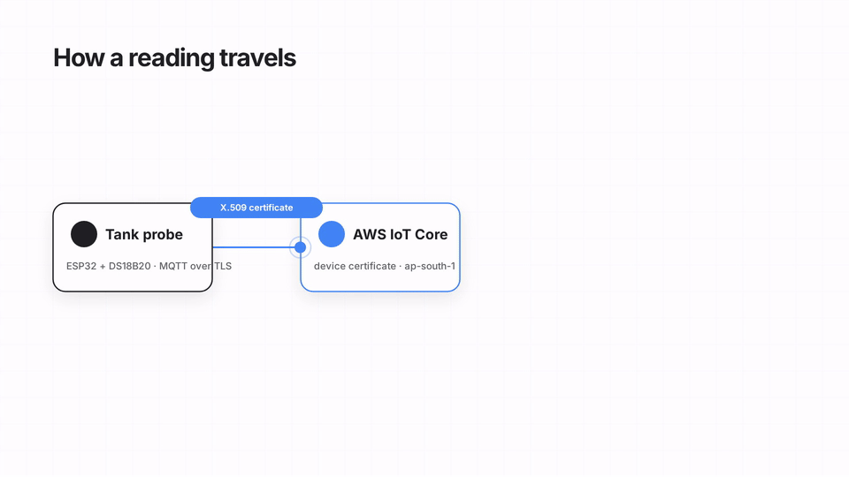</p>

```
ESP32 + DS18B20 ──MQTT/TLS, X.509──▶ AWS IoT Core ──rule dhara_archive──▶ Amazon S3  (raw archive, token removed)
                                          └──────rule dhara_forward──▶ HTTPS ▶ DHARA on Amazon EC2 ▶ validated, stored, audited
Technician / warden browser ──HTTPS──▶ DHARA ──▶ Amazon S3 (private evidence, presigned 300 s)
Anyone with the tank QR ──────────────▶ DHARA public page (read-only)
```

| Service | What DHARA uses it for | Where |
|---|---|---|
| **AWS IoT Core** | One thing per probe with its own X.509 certificate; the policy lets it connect only as itself and publish only to `dhara/<thing>/telemetry`. Two topic rules route every message. | `deploy/aws/iot/` |
| **IoT rule → HTTPS destination** | `dhara_forward` posts each message to `/api/sensors/ingest/`, where DHARA checks the device token (only its SHA-256 is stored), validates time and range, de-duplicates and audits. The destination was confirmed through DHARA's own confirmation handler. | `qr_app/views.py` `sensor_ingest` |
| **Amazon S3** | `dhara_archive` writes one object per message under `dhara/iot-raw/`, with the device token excluded. The same private bucket stores evidence and lab reports: Block Public Access on, SSE-S3, versioning, downloads only through 300-second presigned URLs after DHARA's access check. | `deploy/aws/iot/archive-rule.json`, `project_qr/settings.py` |
| **Amazon EC2** | DHARA (Django 5.2, gunicorn, Docker) on a `t3.micro` in ap-south-1 behind Caddy with Let's Encrypt HTTPS. No SSH port; admin through Systems Manager; IMDSv2 required; S3 access only through the instance role. | `deploy/aws/ec2/` |
| **AWS Systems Manager** | Deploys and admin commands without SSH (`redeploy.sh` ships the commit via S3 + Run Command). | `deploy/aws/ec2/redeploy.sh` |
| **IAM** | An instance role scoped to the app's S3 prefixes, and an IoT role allowed only `s3:PutObject` on `dhara/iot-raw/*`. | `deploy/aws/` |

**Why it stays cheap.** One `t3.micro` (about $0.018/hour with its Elastic IP) and pay-per-message IoT Core. A probe sending every 5 minutes is about 8,600 messages a month.

---

## 6. Inside DHARA

<table><tr>
<td width="50%">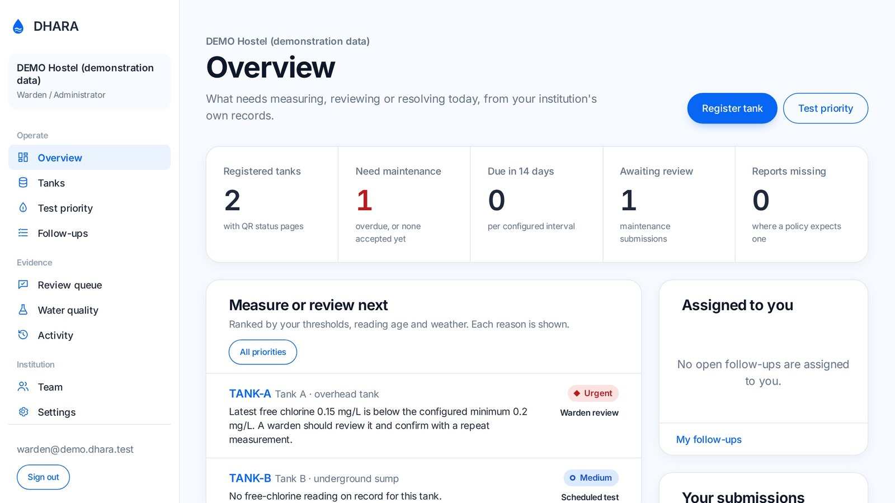<br><sub>Overview: what needs measuring, reviewing or resolving today.</sub></td>
<td width="50%">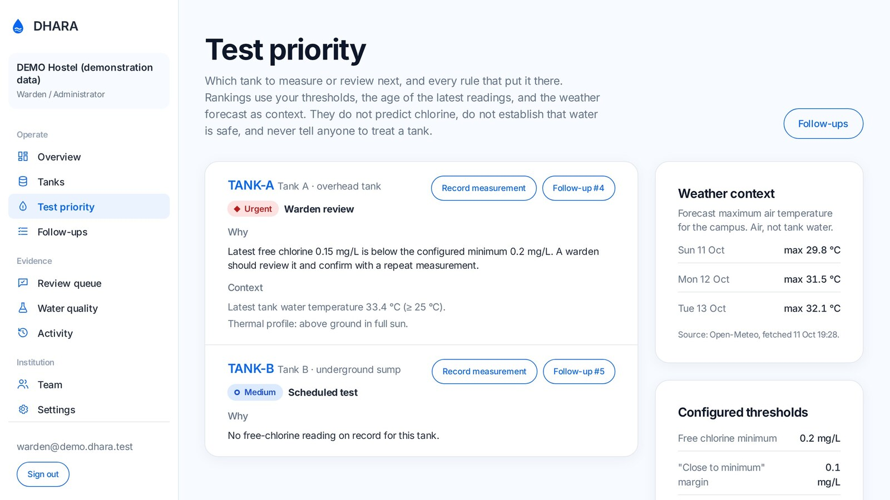<br><sub>Testing priority: every rule and threshold shown.</sub></td>
</tr><tr>
<td>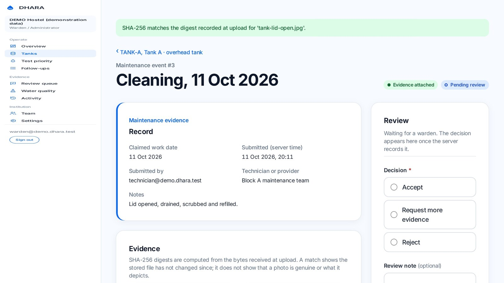<br><sub>"SHA-256 matches the digest recorded at upload."</sub></td>
<td>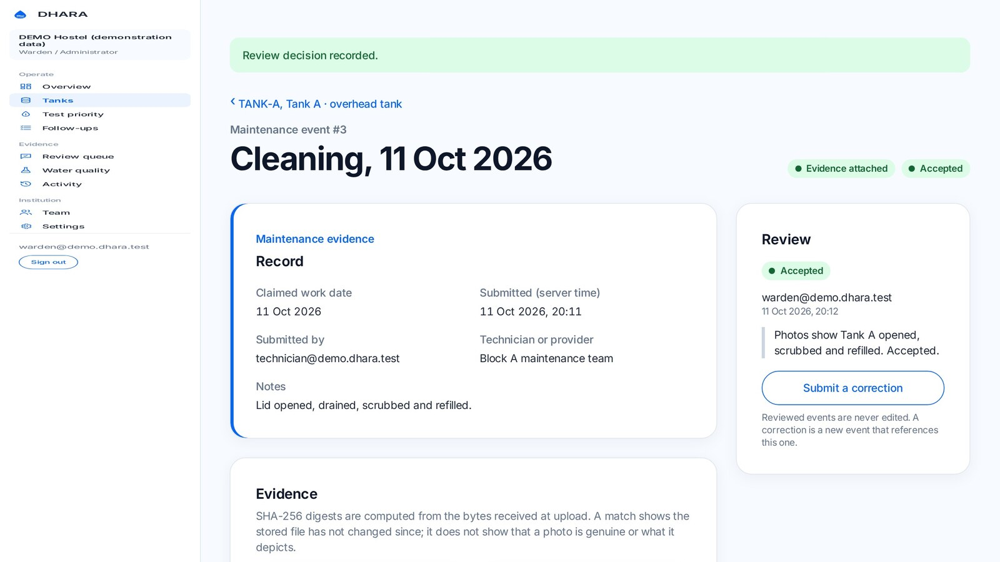<br><sub>Accepted, with the reviewer's name, note and time.</sub></td>
</tr></table>

**Stack:** Django 5.2 · Python 3.12+ · SQLite / PostgreSQL · django-storages + boto3 · WhiteNoise · Tailwind (compiled) · React + TypeScript + Motion for the landing page (Vite build, output committed) · Docker · Caddy.

**Roles:** per-institution memberships (warden / technician). A warden in one institution has no rights in another.

---

## 7. Run it

```bash
git clone https://github.com/Aaditya1273/dhara.git && cd dhara
python -m venv .venv && source .venv/bin/activate
pip install -r requirements.txt -r requirements-dev.txt
cp .env.example .env              # set SECRET_KEY; DEBUG=True for local
python manage.py migrate
python manage.py seed_demo        # demo institution, tanks and logins (printed)
python manage.py runserver        # http://127.0.0.1:8000
python manage.py test qr_app      # 88 tests
```

Front-end assets are prebuilt. To rebuild: `npm install && npm run build:css && npm run build:landing`.

Deploy to EC2: `BUCKET=<bucket> ./deploy/aws/ec2/provision.sh`, then `./deploy/aws/ec2/redeploy.sh` for each new commit. AWS IoT Core setup, step by step: [`deploy/aws/iot/README.md`](deploy/aws/iot/README.md). Run the probe without hardware: paste [`firmware/wokwi/sketch_aws.ino`](firmware/wokwi/sketch_aws.ino) and `diagram.json` into a new Wokwi ESP32 project.

---

## 8. Results

| Check | Result |
|---|---|
| Automated tests | **88 pass** (1 live-S3 test skips without credentials): workflow, permissions, evidence, priority rules, thermal twin, ingest, S3 via moto |
| AWS IoT Core, end to end | Simulated ESP32 → MQTT/TLS with X.509 → `dhara_forward` → DHARA on EC2 stored every reading; `dhara_archive` → **115 objects** in S3 |
| Live run (11 Oct 2026) | New S3 object every ~5 s; DHARA's database received the same readings (34.19 °C, source `dhara-wokwi-01`) |
| Amazon S3 evidence storage | Live test uploads, reads back, verifies SHA-256, checks the presigned URL and deletes: **passes**. Plain object URL returns 403. |
| Amazon EC2 deployment | HTTPS 200, HTTP → HTTPS redirect, security headers, port 22 closed, IMDSv2 required |
| Bug found only on real AWS | Presigned URLs signed for the global S3 endpoint failed outside us-east-1; fixed by signing for the regional endpoint |

---

## 9. Limits (read before quoting anything)

- **The probe is simulated.** The AWS path is verified with a Wokwi ESP32; the firmware has not run on a physical board, and the simulated probe reports a set value, not a tank measurement.
- **DHARA records what people submit.** It cannot confirm that work physically happened, that a photo is genuine or that a lab report is valid. SHA-256 detects later changes, not fakes.
- **The audit log is an ordinary database table,** not a tamper-proof ledger. S3 Object Lock and external anchoring are not yet in place.
- **Testing priority ranks measurement work.** It does not predict chlorine and never declares water safe. DPD strips have limited precision.
- **The thermal twin needs real data:** at least 3 days of hourly readings before validation can pass.
- The live demo uses SQLite on a persistent volume (single instance), not Amazon RDS.

## What's next
Flash the firmware on a physical ESP32 and log a real tank through a summer; move to Amazon RDS; S3 Object Lock for evidence; scheduled reminders; Hindi interface; a pilot with one consenting institution, measuring review turnaround and follow-up closure against its paper process.

## Credits and licences
Built on [QRInvent](LICENSE) (MIT, © 2026 RSLV; the first commit is the unmodified upstream import). Weather: Open-Meteo. Device simulation: Wokwi. Fonts: Inter, Instrument Serif, IBM Plex Mono (SIL OFL). Video photos via Wikimedia Commons: BohunkaNika (CC BY-SA 4.0), Shixart1985 (CC BY 2.0), MohammedSuman22 (CC BY-SA 4.0), SuSanA Secretariat (CC BY 2.0), Massachusetts DEP (CC BY 2.0), Timothy A. Gonsalves (CC BY-SA 4.0). Video music: "Moon Walk" by Eugenio Mininni (Mixkit licence). Voice: Kokoro TTS. Full technical detail, data model, security notes and configuration: [`docs/TECHNICAL.md`](docs/TECHNICAL.md).

## AI tools used
Claude Code (Anthropic) wrote most of the code, tests, documentation and the demo video under the author's direction and review.

## Author
[@Aaditya1273](https://github.com/Aaditya1273)
