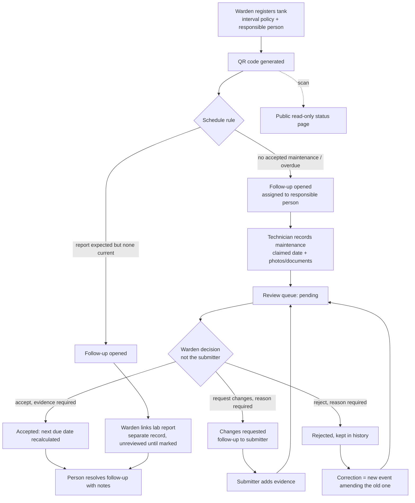
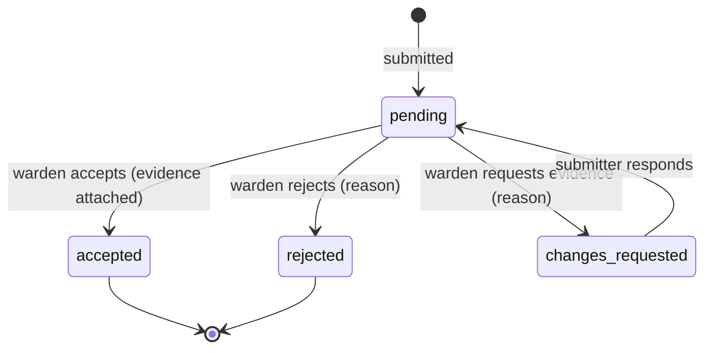
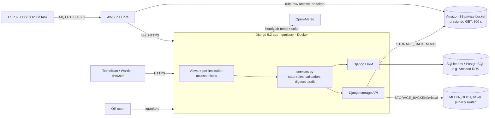
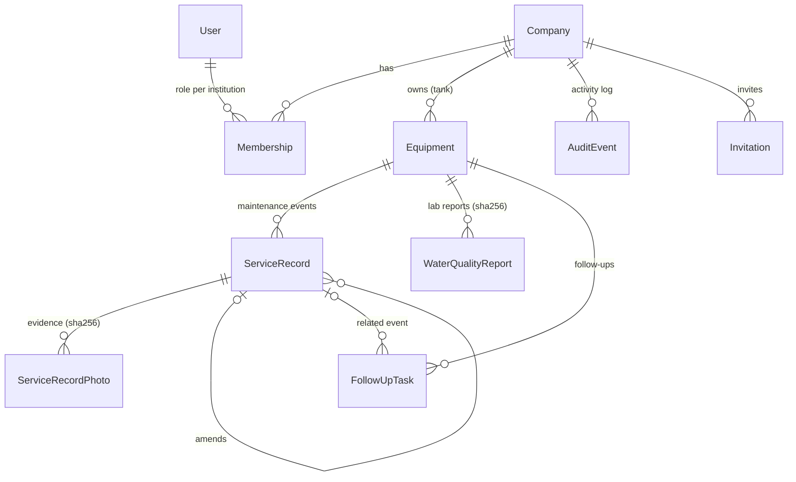

# DHARA — Institutional Water Evidence Ledger

**Track the maintenance. Verify the evidence. Never confuse a cleaning record with water safety.**

DHARA helps hostels, schools and campuses keep water-storage maintenance records, supporting evidence, human review decisions, maintenance schedules and water-quality reports in one traceable workflow. Every tank gets a QR code that opens a read-only status page.

> **Status:** hackathon prototype (Environmental Hacks 2026, Heat & Water track). The features below marked ✅ are implemented and covered by automated tests in this repository. **Amazon S3 evidence storage is verified against real AWS** (ap-south-1, 2026-10-11), and the app is **deployed on Amazon EC2 with HTTPS**. AWS IoT Core is not verified yet; see [AWS integration](#aws-integration).

**New: thermal twin and measured cooling.** A ₹500 in-tank probe (ESP32 + DS18B20) streams tank-water temperature through **AWS IoT Core**. DHARA fits a transparent heat-balance model per tank, validates it on held-out data before showing any forecast, and measures, rather than assumes, whether a cooling intervention (reflective paint, shade, insulation) lowered the tank's daily peak.

**Tank Test Priority.** Summer heat speeds up the loss of chlorine residual in stored water ([*Water Research* 2024 review](https://doi.org/10.1016/j.watres.2024.121913)), and exposed rooftop tanks heat up most. DHARA records real field readings (tank-water temperature, free chlorine) and combines how old they are with the campus weather forecast. It then tells staff **which tank to measure or review next**, with every rule that fired shown in plain words. It ranks *measurement work*; it does not predict chlorine levels or declare water safe.

---

## Contents
[Problem](#the-problem) · [Solution](#the-solution) · [Users](#who-it-is-for) · [Features](#features) · [Workflow](#workflow) · [Architecture](#architecture) · [Data model](#data-model) · [Roles](#roles-and-permissions) · [AWS](#aws-integration) · [Evidence limits](#security-and-evidence-integrity) · [Setup](#local-setup) · [Configuration](#configuration) · [Tests](#migrations-and-tests) · [Deployment](#deployment) · [Demo](#demo-script) · [Impact metrics](#impact-metrics-to-measure) · [Limitations](#known-limitations) · [Roadmap](#roadmap) · [Attribution](#attribution-and-license)

## The problem

Storage tanks need regular cleaning, and institutions need to show that it happened. In practice the record is scattered across paper registers, phone photos, invoices, chat messages and laboratory PDFs. A warden cannot quickly answer: Which tank is overdue? Who submitted the last cleaning, with what evidence? Has anyone reviewed it? Is there a current lab report, and what did it actually test? What is still open, and who owns it?

## The solution

DHARA keeps four things **separate**, because merging them produces false confidence:

| Concept | Question it answers | What it cannot establish by itself |
|---|---|---|
| **Maintenance** | What work was recorded, for which date? | That the work was done correctly or made water potable |
| **Evidence** | Which photos/documents support it? | That a photo is genuine or shows the right tank |
| **Review** | Who checked it and what did they decide? | Independent verification of the physical work |
| **Water quality** | What did a laboratory report for a sample? | That every part of the tank is safe at all times |

There is no blended "safety score". A missing report is shown as **"No water-quality report linked."**, a documentation gap, never a contamination claim.

## Who it is for

- **Wardens / facility administrators**: register tanks, set schedule policy, review submissions, link lab reports, close follow-ups.
- **Technicians / service providers**: record maintenance from a phone and attach evidence; respond to reviewer requests.
- **Students, residents, visitors**: scan a tank's QR code to see a read-only summary.

## Features

✅ Implemented and tested · 🔜 Planned

| | Feature |
|---|---|
| ✅ | **Tank registry**: institution-scoped tank ID, label, building, internal location, capacity, responsible person, configured maintenance interval and optional report interval; search and filters |
| ✅ | **QR codes**: unguessable 144-bit token per tank (not the DB id); PNG download |
| ✅ | **Public QR page** (mobile): latest maintenance, evidence and review status, next due date, latest report date and status, open documentation items, prominent safety disclaimer. No names, notes, files or internal location |
| ✅ | **Maintenance events**: event type, *claimed* work date (no future dates) vs server submission time, provider, notes, before/after photos, supporting documents |
| ✅ | **Independent statuses**: evidence `missing/attached` (derived) and review `pending → accepted / rejected / changes_requested`, validated on the server |
| ✅ | **Review queue**: reviewer and time recorded; reason required to reject or request changes; no self-review; cannot accept without evidence |
| ✅ | **Corrections**: reviewed events are never edited; a correction is a new event linked via `amends` |
| ✅ | **Water-quality reports**: separate model with lab, sample/report dates, parameters, results *as reported*, provenance, original file, institution review flag |
| ✅ | **Due-date engine**: next due = last *accepted* work date + configured interval (Asia/Kolkata dates); statuses `none / overdue / due_soon (14 days) / ok` |
| ✅ | **Follow-ups**: created by the configured schedule rule (maintenance needed, report missing) or by a reviewer requesting changes; assign, re-date, resolve with notes |
| ✅ | **Audit trail**: every registration, submission, upload (with SHA-256), review, report and follow-up action with actor and server time |
| ✅ | **Evidence digests**: SHA-256 of received bytes stored per file; "Re-check digest" recomputes from storage |
| ✅ | **Upload validation**: extension allow-list, 8 MB limit, real content check (Pillow decode / PDF header), generated storage names |
| ✅ | **Private file serving**: evidence and reports only through access-checked views (local) or 5-minute presigned URLs (S3) |
| ✅ | **Per-institution roles** (warden / technician) and invitation links |
| ✅ | **Storage switch**: local disk or private Amazon S3 bucket (django-storages + boto3), tested against mocked S3 |
| ✅ | **Field measurements**: tank-water temperature and free chlorine with measured-at vs entered-at time, method (thermometer/probe, DPD strip/comparator/photometer), entered-by, °F→°C and ppm→mg/L conversion, plausibility ranges (form + DB constraint), audited. Kept separate from lab reports |
| ✅ | **Tank thermal profile**: placement (rooftop, elevated, ground, underground, indoor), sun exposure, material |
| ✅ | **Weather context**: Open-Meteo daily max **air** temperature for the campus location in `TIME_ZONE`, cached for 1 h. It never raises: failures fall back to ranking without weather. Never shown or stored as tank-water temperature |
| ✅ | **Tank Test Priority**: transparent rule engine (`qr_app/priority.py`) ranks tanks for *warden review*, *repeat measurement* or *scheduled test* using configured thresholds, reading age and heat context; each actionable result opens one follow-up per tank (DB-enforced), with the rule reasons in the audit log |
| ✅ | **Sensor ingestion**: register a probe per tank (token shown once, only its SHA-256 stored); `POST /api/sensors/ingest/` validates, de-duplicates and audits readings; handles AWS IoT Core's HTTPS-destination confirmation. Every observation has exactly one source, a person or a device (DB-enforced) |
| ✅ | **Thermal twin** (`qr_app/twin.py`): hourly heat balance `dT = a·G + b·(Tair − T) + c` fitted by least squares on the tank's own data plus Open-Meteo air temperature and solar radiation; free-running hold-out validation; forecast only if plausible and within the error limit, never beyond the validated horizon, out-of-range weather flagged |
| ✅ | **Measured cooling interventions**: measured daily peak vs the pre-intervention model's prediction for the same weather, with a 95% Student-t interval and degree-hours above 30 °C avoided |
| ✅ | **Strip/thermometer photo evidence** on field measurements, stored privately with SHA-256 |
| ⚠️ | **ESP32 firmware and AWS IoT Core setup** (`firmware/`, `deploy/aws/iot/`): written and JSON-validated, **not yet compiled, flashed or run on AWS** |
| 🔜 | Chlorine-decay projection (deliberately not shipped: would need per-site calibration data and validation above 28 °C) |
| 🔜 | Outbreak Radar: tank→block mapping with anonymous symptom counts (future work; needs privacy design and health-authority input) |
| 🔜 | Live S3 + RDS deployment on AWS (code and instructions ready; not yet run against a real account) |
| 🔜 | Email/SMS reminders, Hindi UI translation, CSV/PDF audit export, S3 Object Lock retention |

## Interface and design system

**DHARA Fluid Infrastructure.** One source of truth: `static/css/style.css`. It holds tokens, components, the two shells, the landing styles, motion and reduced-motion rules.

| Layer | What it is |
|---|---|
| Colour | Abyss `#091D25`, River `#164B4C`, Tide `#2E7D79`, Signal `#C9F27A` (only for the primary action and the current-page marker), Mist `#EEF2EE`, Heat `#9A5A10`. Semantic good/warn/bad/info. Chart series water `#008C82`, air `#B8640C` and chlorine `#2266A0` passed a palette validator (lightness, chroma, colour-blind and normal-vision separation, contrast) |
| Type | Anek Latin, a variable font with width and weight axes from the Indian foundry Ek Type, for display; expanded widths on the landing page and normal width in the app. IBM Plex Sans for UI with tabular numerals. IBM Plex Mono only for tank IDs and SHA-256 digests. All self-hosted under SIL OFL; Anek is subset to the characters used |
| Status | Every badge carries a distinct glyph shape (circle, triangle, diamond, ring, bar) as well as colour, so meaning never depends on colour alone |
| Evidence lanes | Field measurements (heat), maintenance (tide) and water quality (info) have separate coloured lanes, so they are never visually merged |
| Motion | Tokens `--ease-flow` (signature), `--ease-ui` and `--ease-exit`, with 140 to 640 ms durations. One landing entrance sequence. Native scroll-driven reveals that are movement-only and never hide text. Cross-page View Transitions. Real upload progress from the browser's upload events. Everything is disabled under `prefers-reduced-motion` |
| Charts | Server-rendered SVG with no chart library. Single series per chart, never a second y-axis. Observed values are solid, forecasts dashed with an approximate band, air temperature dotted. Points have hover and keyboard tooltips, and every chart has a data-table view. Charts appear only from two real readings; otherwise an empty state says what is needed |

**Build:** Tailwind utilities are compiled to `static/css/tw.css` with `npm install && npm run build:css`, and the output is committed, so Node is not needed at runtime. The previous Tailwind CDN dev runtime and Alpine.js were removed. Behaviour lives in `static/js/dhara.js`, about 150 lines of progressive enhancement: every form works without it.

**Measured, 2026-10-11, Lighthouse 12** (simulated mobile, local dev server):
- landing: performance 98, accessibility 100, best practices 100, LCP 2.3 s, CLS 0;
- public QR page: 100 / 100 / 100, LCP 1.8 s.

**Responsive check:** 17 pages at 360, 390 and 768 px with no element wider than the viewport, plus a 5-width pass (including 1366 and 1440) with no console errors.

## Thermal twin

**Model.** For each hour *k*: `T[k+1] − T[k] = a·G[k] + b·(Tair[k] − T[k]) + c`.
- `G` is solar radiation in kW/m². Open-Meteo reports `shortwave_radiation` as the preceding-hour mean, so the value labelled *k+1* is used for the interval starting at *k*.
- `Tair` is air temperature in °C.
- `T` is the measured tank-water temperature, as an hourly mean.
- The equation is linear in *a, b, c*, so ordinary least squares solves it in pure Python. There is no black box.

**Validation (what makes it honest):**
1. Use only hours with a consecutive measured pair and weather data. Require at least 48 training and 24 held-out steps.
2. Fit on the first 75% of steps in time order.
3. **Free-run** the model over the last 25%, which it never saw, starting from one measured value. Report the mean absolute error and RMSE.
4. Reject the model if *a < 0*, if *b* is outside (0, 1), or if the held-out error is above `TWIN_MAX_HOLDOUT_MAE_C` (1.5 °C).
5. Forecast from the latest measured hour only if it is under 3 h old, and **never further ahead than the validated span**.
6. The band is ±1.96 × held-out RMSE, labelled approximate. Hours with weather outside the training range are flagged and left out of the peak.

**Intervention effect:**
- Fit and validate the twin on data *before* the change.
- For each later day with 18 or more logged hours, simulate the day from its first measurement, then compare the measured daily peak with the predicted one.
- Report the mean difference, a 95% Student-t interval and the degree-hours above 30 °C avoided.
- This assumes nothing else changed (refill schedule, water use, sensor position). If the interval includes zero, DHARA says there is no clear effect.

**Why it matters:**
- Chlorine-decay models are validated only up to 28 °C (Fisher et al., 2012).
- The 2026 IIT Madras E. coli model lacked water temperature and chlorine as inputs.
- Radiative-cooling paints are tested on roofs, boxes and grain silos, but in our search we found no published test on drinking-water tanks. Performance is also known to drop in humid tropics.

DHARA measures these things rather than assuming them.

## Tank Test Priority

**Rules** (in order; the first chlorine rule that matches wins). Thresholds come from environment variables and are shown on the page.

| # | Condition | Result |
|---|---|---|
| 1 | No free-chlorine reading on record | **Scheduled test**: *medium*, or *high* with heat context |
| 2 | Latest reading older than `CHLORINE_MAX_AGE_HOURS` (72 h) | **Scheduled test**: *medium*, or *high* with heat. A stale low reading triggers a re-test, never an alarm |
| 3 | Fresh reading **below** `CHLORINE_MIN_MG_L` (0.2) | **Warden review**: *urgent*, confirm with a repeat measurement |
| 4 | Fresh reading above `CHLORINE_MAX_MG_L` (1.0) | **Warden review**: *medium* |
| 5 | Fresh reading within `CHLORINE_NEAR_MARGIN_MG_L` (0.1) of the minimum | **Repeat measurement**: *medium*, or *high* with heat |
| 6 | Heat context and the reading is older than `WARM_RETEST_HOURS` (24 h) | **Repeat measurement**: *medium* |
| 7 | Sun-exposed tank, hot forecast, no recent water-temperature reading | **Scheduled test** (temperature): *low* |
| – | Placement or sun exposure unknown | Informational only, no follow-up |

**Heat context** means the forecast max air temperature is ≥ `FORECAST_HOT_C` (35 °C), or a fresh tank-water reading is ≥ `WATER_WARM_C` (25 °C). Heat only raises urgency; it never creates a "below threshold" finding by itself.

**Boundaries:**
- *below* is strict (`<`): exactly 0.2 mg/L is not below the minimum;
- *fresh* is inclusive (`≤ 72 h`);
- *warm* and *hot* are inclusive (`≥`).

All of these are unit-tested.

**Default thresholds.** Chlorine defaults follow IS 10500:2012: free residual chlorine minimum 0.2 mg/L at the consumer end (0.5 mg/L where viral protection is needed), permissible 1.0 mg/L. The temperature defaults are policy choices. Every value can be changed.

**What it does not do:**
- It does not project chlorine decay.
- It does not claim that a chlorine reading proves potability.
- It does not attribute illness.
- It does not tell anyone to chlorinate or isolate a tank. A warden decides and records the action through the follow-up workflow.

## Workflow



Review states (maintenance) and report states (water quality) are independent:


`WaterQualityReport`: `unreviewed → reviewed`. A report never changes maintenance status, and vice versa.

## Architecture



Server-rendered Django templates with Tailwind (CDN) and Alpine.js for the mobile menu. No frontend framework and no ML model: the workflow is the product.

## Data model



Model names keep the upstream QRInvent names (`Equipment` = tank, `ServiceRecord` = maintenance event, `ServiceRecordPhoto` = evidence) to keep the adaptation traceable. DB constraints: unique tank ID per institution; a decided review must have a reviewer and time; a resolved task must have a resolver; report date ≥ sample date; one open rule-generated task per tank and kind. Evidence, events and reports use `PROTECT`, so history cannot be deleted by cascading.

## Roles and permissions

All checks are on the server (`qr_app/mixins.py`, `qr_app/services.py`). Every query is filtered by the institution in the URL *and* the user's membership in it; another institution's IDs return 404/403.

| Action | Warden / Administrator | Technician | Public (QR) |
|---|:-:|:-:|:-:|
| View tanks, events, evidence, reports, follow-ups | ✅ | ✅ | summary only |
| Register / edit tanks, set policy | ✅ | ❌ | ❌ |
| Submit maintenance + evidence | ✅ | ✅ | ❌ |
| Review maintenance | ✅ (not own) | ❌ | ❌ |
| Respond to "changes requested" | ✅ | own events | ❌ |
| Link / mark-review lab reports | ✅ | ❌ | ❌ |
| Assign follow-ups | ✅ | ❌ | ❌ |
| Resolve follow-ups | ✅ | if assigned | ❌ |
| Invite / remove members, activity log | ✅ | ❌ | ❌ |

Roles live on `Membership`, so being a warden in one institution grants nothing in another. Inviting an existing account requires that person to be signed in as that account.

## AWS integration

**AWS IoT Core: tank probes** (written; not yet run on AWS).
- Each probe is an IoT *thing* with its own X.509 certificate. Its policy allows it to connect only as itself and to publish only to `dhara/<thing>/telemetry`.
- Rule 1 archives raw readings to S3 under `dhara/iot-raw/`, with the device token excluded.
- Rule 2 forwards the readings over HTTPS to `/api/sensors/ingest/`, where DHARA checks the device token and validates every reading.
- Setup steps, policies and a verification checklist are in [`deploy/aws/iot/README.md`](deploy/aws/iot/README.md).

**Amazon S3: evidence and report storage** ✅ **verified on real AWS, 2026-10-11.**

**Bucket:** private, in `ap-south-1`.
- All four Block Public Access settings on.
- Object ownership `BucketOwnerEnforced`, so ACLs are disabled.
- Default SSE-S3 (AES256) encryption with Bucket Key.
- Versioning enabled.

**What was checked:**
- The **live test** `LiveS3Tests` uploads, reads back, verifies SHA-256, checks the presigned URL and deletes. It **passes**.
- **End-to-end through the app** with `STORAGE_BACKEND=s3`, on a throwaway database and the labelled demo photo:
  - a maintenance-evidence upload is stored as an encrypted object whose size matches the database;
  - the digest re-check against S3 passes;
  - the in-app download redirects to a **presigned URL that returns 200**;
  - the **plain object URL returns 403**;
  - an anonymous user is redirected to login.
- Test objects were removed afterwards.

**Bug found only by the live test, and fixed.** Presigned URLs were signed for the global S3 endpoint. Buckets outside `us-east-1` answer with a 307 redirect to the regional host, so the signature failed (403). DHARA now signs for `https://s3.<region>.amazonaws.com` with virtual-hosted addressing.

**Implementation:**

- `STORAGE_BACKEND=s3` switches Django's default storage to `storages.backends.s3.S3Storage`.
- Objects get generated keys (`dhara/evidence/<institution>/<uuid>.<ext>`), no ACL (bucket stays private), no overwrite.
- Downloads go through DHARA's access check, then a 300-second presigned URL.
- If an S3 write fails, the database transaction rolls back and the user sees "could not be stored, nothing was saved".
- The SHA-256 digest stored in the DB can be re-checked against the S3 object from the event page.

**Verification status:**
- `MockedS3Tests` runs the real django-storages/boto3 path against [moto](https://github.com/getmoto/moto). It checks the object exists, has no public grant, its digest verifies, and downloads redirect to a signed URL. **Passing.**
- `LiveS3Tests` uploads, reads back, verifies and deletes against a real bucket. **Skipped**: no AWS credentials were available while building. To run:
  ```bash
  export AWS_ACCESS_KEY_ID=... AWS_SECRET_ACCESS_KEY=... AWS_REGION=ap-south-1
  DHARA_S3_TEST_BUCKET=your-private-test-bucket python manage.py test qr_app.tests.LiveS3Tests
  ```
- **Recommended bucket setup:** Block Public Access on, SSE-S3 encryption, versioning on. Give the app an IAM role with `s3:PutObject`, `s3:GetObject`, `s3:DeleteObject` on `arn:aws:s3:::BUCKET/dhara/*` and `s3:ListBucket` on the bucket.
- **Database:** any PostgreSQL through `DATABASE_URL`, e.g. Amazon RDS. No LLM or AI service is used or needed.

## Security and evidence integrity

| Mechanism | Useful for | Not proof of |
|---|---|---|
| Server submission time | When DHARA received the record | When the work physically happened (that is the *claimed* date) |
| SHA-256 digest | Detecting later changes to the stored file | That the photo is genuine, unedited at capture, or shows this tank |
| Human review | Who decided what, when, and why | Independent verification of the work |
| Lab report | What a lab reported for one sample and parameter set | Continuous safety of all water |
| Audit table | A readable trail of actions | Tamper-proofing: it is an ordinary DB table that a DB administrator could alter |

**Controls in place:**
- CSRF on all forms
- per-institution query scoping
- server-side transitions with row locks
- upload type, size and content validation
- no public media route
- templates auto-escaped (no `|safe`)
- axes login lockout
- OTP-protected admin site
- `SECRET_KEY` required outside DEBUG
- secure cookies, HSTS (configurable) and SSL redirect in production
- `manage.py check --deploy` is clean apart from the opt-in HSTS subdomain and preload warnings

**Not yet done:**
- rate limiting beyond login
- antivirus scanning of uploads
- S3 Object Lock
- external log anchoring
- a formal security review

Do not call this production-secure until those are assessed.

## Local setup

Requires Python 3.12–3.14.

```bash
git clone https://github.com/Aaditya1273/dhara.git && cd dhara
python -m venv .venv && source .venv/bin/activate
pip install -r requirements.txt -r requirements-dev.txt
cp .env.example .env            # then set SECRET_KEY; DEBUG=True for local
python manage.py migrate
python manage.py seed_demo      # prints demo logins; writes demo_files/
python manage.py runserver
```
Open http://127.0.0.1:8000, or register your own institution at `/register/`.

## Configuration

See `.env.example`. Variables read by the app:

| Variable | Default | Purpose |
|---|---|---|
| `SECRET_KEY` | required unless `DEBUG=True` | Django signing key |
| `DEBUG` | `False` | Never `True` in production |
| `ALLOWED_HOSTS` | `127.0.0.1,localhost` | Comma-separated hostnames |
| `CSRF_TRUSTED_ORIGINS` | empty | e.g. `https://dhara.example.org` |
| `DATABASE_URL` | SQLite file | `postgres://…` for production |
| `TIME_ZONE` | `Asia/Kolkata` | Due-date calendar |
| `STORAGE_BACKEND` | `local` | `local` or `s3` |
| `AWS_STORAGE_BUCKET_NAME`, `AWS_REGION`, `AWS_S3_PREFIX` | –, `ap-south-1`, `dhara` | S3 settings |
| `SECURE_SSL_REDIRECT`, `SECURE_HSTS_SECONDS` | `True`, `0` | Production HTTPS policy |
| `PRIORITY_*` | see `.env.example` | Tank Test Priority thresholds |
| `OPEN_METEO_URL`, `OPEN_METEO_TIMEOUT` | Open-Meteo API, `5` s | Weather forecast source |
| `BILLING_ENABLED` | `False` | Re-enables upstream QRInvent YooKassa billing. Leave off for DHARA |
| `LOG_LEVEL` | `INFO` | Console logging |

## Migrations and tests

```bash
python manage.py makemigrations --check   # no pending model changes
python manage.py migrate
python manage.py test qr_app              # 87 tests; LiveS3Tests skipped without a bucket
```
The suite covers:
- tank creation and validation, QR token resolution
- public page field exposure and no contamination claims
- submission, upload rejection, oversize files, storage-failure rollback
- review accept/reject/changes, unauthorized and self review, transitions
- cross-institution access, per-institution roles, invitation ownership
- report independence, due-date policy, rule follow-ups, assign/resolve
- digest tamper detection, mocked S3 privacy, legacy pages and billing gate

## Deployment

**Live demo deployment (verified 2026-10-11).** EC2 `t3.micro` in `ap-south-1`, running Amazon Linux 2023 with Docker.

**How it is set up:**
- Caddy issues a Let's Encrypt certificate for `<elastic-ip>.sslip.io`.
- Port 80 redirects to 443 (308), and **no SSH port is open**. Admin access goes through AWS Systems Manager.
- The app gets AWS credentials only from the instance role `dhara-ec2`. Its S3 access is limited to `dhara-prod/*` and `deploy/*`.
- IMDSv2 is required, with a hop limit of 2 so the container can reach the role.
- The SQLite database sits on a persistent Docker volume, which is acceptable for this single-instance demo.

**Verified on the live server:**
- the certificate chain;
- the HTTP to HTTPS redirect;
- the security headers;
- port 22 closed;
- static files served;
- the in-container S3 write/read/delete using the role;
- a real login and the core pages.

**Commands:**
```bash
BUCKET=<bucket> ./deploy/aws/ec2/provision.sh   # create (≈ $0.018/hour in ap-south-1 incl. Elastic IP; billed hourly)
BUCKET=<bucket> ./deploy/aws/ec2/redeploy.sh    # ship the current commit via S3 + Systems Manager
./deploy/aws/ec2/teardown.sh                    # stop all server charges (EMPTY_BUCKET=1 BUCKET=… also empties S3)
```

**Other hosting:**
The simplest credible AWS path is a container on **AWS App Runner** or **ECS Fargate**, with **RDS PostgreSQL** and a private **S3** bucket:

```bash
docker build -t dhara .
docker run -p 8000:8000 --env-file .env.production dhara   # runs migrate, then gunicorn
```

1. Create a private S3 bucket (see the policy above) and an RDS PostgreSQL database.
2. Push the image to Amazon ECR and create an App Runner service from it. Give its instance role the S3 permissions above.
3. Set the environment: `SECRET_KEY`, `DEBUG=False`, `ALLOWED_HOSTS`, `CSRF_TRUSTED_ORIGINS`, `DATABASE_URL`, `STORAGE_BACKEND=s3`, `AWS_STORAGE_BUCKET_NAME`, `AWS_REGION`.
4. Point the health check at `/healthz/`. It is exempt from the SSL redirect.
5. Create the first warden through `/register/`, or run `python manage.py seed_demo` once for a demo.

Static files are served by WhiteNoise. Don't use SQLite or local media storage on ephemeral or multi-instance hosts.

**Troubleshooting**

| Symptom | Fix |
|---|---|
| `ImproperlyConfigured: SECRET_KEY must be set` | Set `SECRET_KEY` or `DEBUG=True` locally |
| `DisallowedHost` | Add the host to `ALLOWED_HOSTS` |
| CSRF failure behind HTTPS proxy | Set `CSRF_TRUSTED_ORIGINS` |
| Redirect loop behind a load balancer | It must send `X-Forwarded-Proto`, or set `SECURE_SSL_REDIRECT=False` and terminate TLS upstream |
| `AWS_STORAGE_BUCKET_NAME is required` | Set it, or use `STORAGE_BACKEND=local` |
| Uploads fail with "could not be stored" | Check S3 permissions and the region; the app log has the boto3 error |

## Demo script

`python manage.py seed_demo` creates **"DEMO Hostel (demonstration data)"** with:
- `warden@demo.dhara.test` and `technician@demo.dhara.test` (password printed, or set with `--password`)
- Tank A (180-day maintenance and report policy) and Tank B
- `demo_files/`: labelled demo photos and a PDF that says "SAMPLE REPORT – NOT A REAL LABORATORY RESULT"

1. **Warden:** Tanks → Register tank, or use Tank A. Show the QR code on the tank page.
2. **Overview:** "Need maintenance" counts Tank A, and follow-ups were opened by the schedule rule.
3. **Technician (phone width):** Tank A → Record maintenance → attach `DEMO-before.png` and `DEMO-after.png` → Submit. The event shows *Pending review*.
4. **Warden:** Review queue → open the event → Accept with a note, or request more evidence to show the round trip.
5. **Scan the QR, or open the public page:** last accepted maintenance, next due date, *Evidence attached · Accepted*, and "No water-quality report linked."
6. **Warden:** Link water-quality report → upload the SAMPLE PDF. The public page now shows the lab and sample date as *Uploaded, not yet reviewed*. Maintenance status is unchanged.
7. **Follow-ups:** assign one, then resolve it with notes ("Cleaned, event #1 accepted").
8. **Activity:** the full trail with SHA-256 digests. On the event page, "Re-check digest" verifies the stored file.
9. **Thermal twin (real probe data only):** register a sensor on the tank, flash the ESP32 and let it log for **at least 3 days**: 72 consecutive hourly steps are needed before validation can pass. Before then, the tank page shows how much more data is needed. Once it passes, it shows the held-out error, the forecast chart and the forecast peak. Test Priority then uses the forecast water temperature.
   **Cooling result:** log the intervention (for example white paint) after 3+ days of baseline, then keep logging 3+ more days. The tank page reports the measured effect with its confidence interval, whatever it turns out to be.
10. **Test priority (real readings only):** open *Test priority*. With no readings, both tanks show "No free-chlorine reading on record" and get one follow-up each. Take a **real** DPD strip and thermometer reading at an actual tank (yours or a hostel's) and enter it under *Record measurement*. The ranking updates and shows the rule that fired. The weather panel shows the live Open-Meteo forecast for the campus location (`seed_demo --lat/--lon`). If the real forecast is below 35 °C, heat context honestly stays off. To show the heat rule, change `PRIORITY_FORECAST_HOT_C` and say on camera that it is a policy setting.
11. **AWS:** follow `deploy/aws/iot/README.md`, show the MQTT test client receiving probe messages and the S3 raw archive, and run with `STORAGE_BACKEND=s3`, upload evidence and show the private object and presigned URL. This needs a real bucket.

## Impact metrics to measure

Measure these in a pilot; DHARA makes no outcome claims yet.

| Metric | Definition |
|---|---|
| Maintenance coverage | Share of tanks with a configured interval and a responsible person |
| Schedule adherence | Share of tanks not in `none`/`overdue` status |
| Evidence completeness | Share of submitted events with evidence before review |
| Review turnaround | Submission time to review decision |
| Follow-up closure | Share of follow-ups resolved, and median time to resolve |
| Record retrieval time | Time for a warden to produce a tank's history, compared with the paper baseline |
| Report linkage | Share of tanks with a report policy that have a current report |

Water-quality outcomes need proper testing and a separate evaluation.

## Known limitations

- DHARA records what users submit. It cannot confirm that work physically happened as described.
- Photos cannot establish microbiological or chemical safety. A linked PDF does not prove the laboratory, the chain of custody or the validity of the results.
- A QR code is only as trustworthy as the registration and physical labelling behind it.
- The audit log, timestamps and digests aid traceability. They are not proof against administrator-level tampering.
- Schedule intervals are whatever the institution configures. DHARA encodes no legal standard.
- Rule-based follow-ups are generated when the overview or follow-up page loads. There is no background scheduler or notifications yet.
- The twin is a single-node lumped model. It ignores stratification, refills and draw-off except as an average term (*c*), and is only as good as its held-out validation on that tank.
- An intervention effect is an observational before/after comparison against a model, not a randomised trial. A second untreated tank logged in parallel makes it far more convincing.
- The ESP32 firmware and AWS IoT setup have not been compiled, flashed or run.
- Test Priority uses the readings people enter. It cannot detect a falsified reading, and DPD strips have limited precision.
- The thermal profile is descriptive context. DHARA does not estimate tank-water temperature from air temperature.
- Weather comes from a third-party forecast (Open-Meteo) and is shown only as air-temperature context.
- No email delivery: invitations are links the warden shares by hand.
- The Tailwind CDN build is fine for the prototype; for production, compile the CSS.
- The upstream billing templates (YooKassa) are still in Russian and only reachable with `BILLING_ENABLED=True`.

## Roadmap

1. Live AWS deployment (App Runner + RDS + S3) and the live S3 test in CI.
2. Field pilot for Test Priority: collect paired temperature and chlorine readings across summer to learn whether a per-site chlorine-decay estimate is justified, before shipping any projection.
3. **Outbreak Radar** (future): map tanks to hostel blocks and watch anonymous daily GI case counts. This needs a privacy review, an institutional ethics process and health-authority involvement before any build.
4. Pilot with one consenting institution. Measure the metrics above against its current process.
5. Scheduled reminders, CSV/PDF export of a tank's history, Hindi interface.
6. Stronger integrity: S3 versioning plus Object Lock for evidence, and periodic export of audit digests.

## Attribution and license

DHARA is built on **[QRInvent](LICENSE)**, a Django QR equipment-maintenance starter © 2026 RSLV, used under the **MIT License** (kept in `LICENSE`). The first commit in this repository is the unmodified upstream import.

**Adapted from QRInvent:**
- Django project layout and multi-institution URL scheme (`/<institution>/…`)
- user, company and membership models, invitations and registration
- QR generation with `qrcode`
- the service-record and photo concept (now maintenance events and evidence)
- axes and OTP security setup
- the YooKassa subscription code (kept but disabled by default)

**Original to DHARA:**
- tank schema and due-date engine
- independent review workflow with transition rules, no self-review and amendments
- evidence kinds and SHA-256 digests, with upload content validation
- water-quality report model
- follow-up tasks (schedule rule and reviewer-created)
- audit log
- per-institution roles, which fix upstream's global role escalation
- public QR status page
- private file serving and the S3 storage backend
- the whole interface and design system
- the test suite, the demo seed command and the Docker/deployment setup

**Removed from upstream:**
- the generic equipment-template and custom-field builder, which the tank schema replaces (it also had a cascade that deleted all equipment when a template was deleted)

**AI tools:** implementation was developed with Claude Code (Anthropic) as a coding assistant, under the author's direction and review.

## References

- National Health Mission, *Kayakalp Implementation Guidebook*: tank-cleaning record guidance for healthcare facilities. It does not apply to every hostel or school by default. [PDF](https://nhm.gov.in/images/pdf/in-focus/Implementation_Guidebook_for_Kayakalp.pdf)
- BIS, *IS 10500:2012 Drinking Water Specification*: free residual chlorine. [PDF](https://consumerhelpline.gov.in/public/assets/docs/bis/IS10500-2012.pdf)
- Furst, Graham, Weisman & Adusei, "It's getting hot in here: effects of heat on temperature, disinfection and opportunistic pathogens in drinking water distribution systems", *Water Research* 2024. [DOI](https://doi.org/10.1016/j.watres.2024.121913)
- Fisher et al., temperature-dependent chlorine bulk decay model (validated 3.5–28 °C), *Water Research* 2012. [DOI](https://doi.org/10.1016/j.watres.2012.03.017)
- Kagan et al., *People's Water Data* (IIT Madras), arXiv 2604.04240 (2026): notes free chlorine and water temperature were not available as predictors. [arXiv](https://arxiv.org/abs/2604.04240)
- Amazon S3 docs: [object integrity](https://docs.aws.amazon.com/AmazonS3/latest/userguide/checking-object-integrity.html) · [Versioning](https://docs.aws.amazon.com/AmazonS3/latest/userguide/Versioning.html) · [Object Lock](https://docs.aws.amazon.com/AmazonS3/latest/userguide/object-lock.html)
